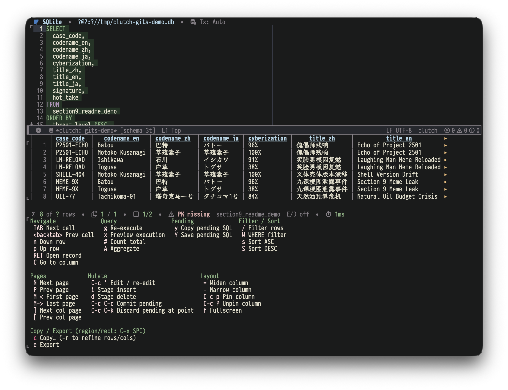

[](https://melpa.org/#/clutch)

<p align="center">
  <picture>
    <source media="(prefers-color-scheme: dark)" srcset="docs/logo/clutch-dark.svg">
    
  </picture>
</p>

<p align="center"><strong>Query and browse databases, inspect results, and stage SQL row edits without leaving Emacs.</strong></p>

Clutch runs queries from ordinary editable buffers, shows results in an interactive grid, and lets you stage and preview SQL row edits before committing them. It connects directly in Emacs Lisp to MySQL, PostgreSQL, XTDB, SQLite, MongoDB, and Redis, and uses a small Java sidecar for JDBC databases including Oracle, SQL Server, DuckDB, ClickHouse, Snowflake, Redshift, DB2, and Cassandra.



## Quick Start

The fastest way to try Clutch is with SQLite, which uses Emacs 29.1+'s built-in SQLite support and needs no extra package or Java runtime.

### 1. Install Clutch

With MELPA configured:

```emacs-lisp
(package-install 'clutch)
```

### 2. Open a SQLite database

```text
M-x clutch-query-sqlite-file
```

Pick a SQLite file to open a connected SQL console.

### 3. Run a query

```sql
SELECT sqlite_version();
```

Press `C-c C-c`. Clutch runs the active region if one is selected, or the statement at point otherwise, and opens the result grid below.

For MySQL, PostgreSQL, MongoDB, Redis, or JDBC, see [Installation Details](#installation-details) and the [user guide](docs/user-guide.md).

## Key Capabilities

- **In-buffer query execution:** Run a region, statement, or script without leaving your SQL buffer. Supported backends (MySQL, PostgreSQL, JDBC) run queries asynchronously so Emacs stays responsive, with running/finished markers in the fringe or terminal margin.
- **Interactive result grid:** Page through results, scroll horizontally by column, filter the current page (`/`), sort (`s`), open vertical record views (`RET`), and inspect JSON, XML, or BLOB values (`v`, or optional child-frame previews).
- **Staged SQL row editing:** Stage inserts, cell edits, and deletes locally, inspect the generated SQL before sending, and submit inside a transaction or savepoint. Edits are allowed only when Clutch can identify a stable source row (see [row-editing boundaries](docs/user-guide.md#row-editing-boundaries)).
- **Completion and object browsing:** Complete tables, schemas, and columns (including subqueries and aliases), jump to definitions and DDL (`C-c C-j` / `C-c C-d` / `C-c C-o`), follow foreign keys, and compare table definitions across connections in Ediff ([object workflow](docs/interactive-client.md#compare-table-definitions)).
- **ER view and manual relations:** Inspect incoming and outgoing foreign keys in an interactive table overview, and record extra relations in a Git-friendly JSON file ([ER guide](docs/interactive-client.md#er-view-clutch-er-mode-key-bindings)).
- **Query plans:** View PostgreSQL, MySQL, and SQLite execution plans as a tree with per-step cost or `EXPLAIN ANALYZE` timing bars (`E` in `C-c ?`).
- **Copy and export:** Copy cells or rectangles as TSV, CSV, Org tables, `INSERT`, or `UPDATE`, or export full query/grid results to CSV or TSV files (streaming in a single query on JDBC and current native MySQL/PostgreSQL drivers).
- **Transactions and transports:** Manage auto-commit, commit, and rollback across consoles and result buffers, store credentials in `pass` or `.authinfo.gpg`, and tunnel over `~/.ssh/config` or TRAMP.
- **Native or JDBC backends:** Use pure-Elisp protocol packages where available, or the Java 17+ [clutch-jdbc-agent](https://github.com/LuciusChen/clutch-jdbc-agent) for JDBC databases.

## Backend Support

| Backend | Support level | Requirements and notes |
|---|---|---|
| MySQL | Core SQL | Requires [`mysql`](https://melpa.org/#/mysql) (MELPA); tested with MySQL 5.6, 8.0, 8.4 LTS, and MariaDB 10.11 |
| PostgreSQL | Core SQL | Requires [`pgsql`](https://melpa.org/#/pgsql) (MELPA) |
| XTDB | Basic SQL over PostgreSQL protocol | Requires [`pgsql`](https://melpa.org/#/pgsql); staged edits submit in Auto mode |
| SQLite | Core SQL | Built into Emacs 29.1+; no extra dependency |
| Oracle / SQL Server | Core SQL via JDBC | Requires Java 17+ and `clutch-jdbc-agent.jar` |
| DuckDB | Core SQL via generic JDBC | File-backed `jdbc:duckdb:...` URL and DuckDB JDBC driver |
| MongoDB | Basic native document; optional SQL Interface | Native mode requires `mongodb.el`; SQL Interface uses `:surface sql-interface` via JDBC |
| Redis | Basic key/value | Requires `redis.el`; line-oriented console, key browsing, and type-aware values |
| Cassandra | Basic CQL via JDBC | CQL console, bounded read-only results, and table/column browsing |
| ClickHouse / Snowflake / Redshift / DB2 / generic JDBC | Basic SQL | Query and metadata first; editing, transaction, and dialect support vary by driver |

See [Backend support levels](docs/backend-support.md) for the exact scope of each backend.

## Installation Details

SQLite works out of the box. For other backends, install only the protocol package you need:

| Backend | Extra Emacs package |
|---|---|
| `:backend mysql` | [`mysql`](https://melpa.org/#/mysql) ([mysql.el](https://github.com/LuciusChen/mysql.el)) |
| `:backend pg` | [`pgsql`](https://melpa.org/#/pgsql) ([pgsql.el](https://github.com/LuciusChen/pgsql.el)) |
| `:backend xtdb` | [`pgsql`](https://melpa.org/#/pgsql) ([pgsql.el](https://github.com/LuciusChen/pgsql.el)) |
| `:backend mongodb` | [mongodb.el](https://github.com/LuciusChen/mongodb.el) |
| `:backend redis` | [redis.el](https://github.com/LuciusChen/redis.el) |
| `:backend sqlite` | None (built into Emacs 29.1+) |
| `:backend jdbc` / Oracle / SQL Server / Snowflake / Redshift / ClickHouse / DB2 / DuckDB / Cassandra | None in Emacs (uses the bundled JDBC adapter) |

If a configured protocol package is missing, Clutch tells you when you connect.

`nerd-icons` is optional; without it, Clutch falls back to plain text symbols. Availability is checked once per Emacs session, so restart Emacs after installing it.

JDBC backends require Java 17+, `clutch-jdbc-agent.jar` (pinned at 0.2.35 and SHA-256 verified on startup), and the database's JDBC driver jar. Run `M-x clutch-jdbc-ensure-agent` to download the agent and `M-x clutch-jdbc-install-driver` for supported drivers. See the [JDBC backend guide](docs/jdbc-backend.md) for setup and connection examples.

When installing from source checkouts, add Clutch and any native protocol checkouts you use to `load-path`:

```emacs-lisp
(add-to-list 'load-path "/path/to/clutch")
(add-to-list 'load-path "/path/to/mysql.el")   ; only for :backend mysql
(add-to-list 'load-path "/path/to/pgsql.el")   ; only for :backend pg
(add-to-list 'load-path "/path/to/mongodb.el") ; only for :backend mongodb
(add-to-list 'load-path "/path/to/redis.el")   ; only for :backend redis
(require 'clutch)
```

Org-Babel integration lives in the separate [ob-clutch](https://github.com/LuciusChen/ob-clutch) package.

## Requirements

- Emacs 29.1+
- MySQL 5.6+ / MariaDB 10.11, PostgreSQL 12+, or SQLite for the native SQL backends (`mysql_old_password` is not supported)
- Java 17+ for JDBC backends
- `mongodb.el` or `redis.el` for native MongoDB or Redis

## Documentation

- [User guide](docs/user-guide.md) — saved connections, query and export basics, transactions, passwords and encrypted profiles, SSH tunnels, TRAMP, and `.sql` files.
- [Interactive client guide](docs/interactive-client.md) — key bindings, result browser, editing/insert forms, ER view, query plans, object actions, REPL, menus, faces, and options.
- [Backend support levels](docs/backend-support.md) — what each backend supports and where non-relational/JDBC limits sit.
- [Native backend guide](docs/native-backends.md) — MySQL, PostgreSQL, XTDB, SQLite, MongoDB, and Redis details, TLS, and timeouts.
- [MongoDB backend guide](docs/mongodb-backend.md) — MQL helpers, completion, read-only document grids, and SQL Interface setup.
- [JDBC backend guide](docs/jdbc-backend.md) — agent/driver installation, connection examples, Oracle/DuckDB/Snowflake/Cassandra notes, and transactions.
- [Org-Babel guide](docs/org-babel.md) — `ob-clutch` setup, block examples, header arguments, and caching.
- [Architecture guide](docs/architecture.md) — module layout, dependencies, and runtime diagrams.
- [JDBC agent protocol](docs/jdbc-agent-protocol.md) — stdin/stdout JSON protocol and sidecar session model.
- [Product requirements](PRD.md) — scope and design goals.

For development and tests, see [CONTRIBUTING.md](CONTRIBUTING.md) and [AGENTS.md](AGENTS.md).

## License

GPL-3.0-or-later. See [LICENSE](LICENSE).
