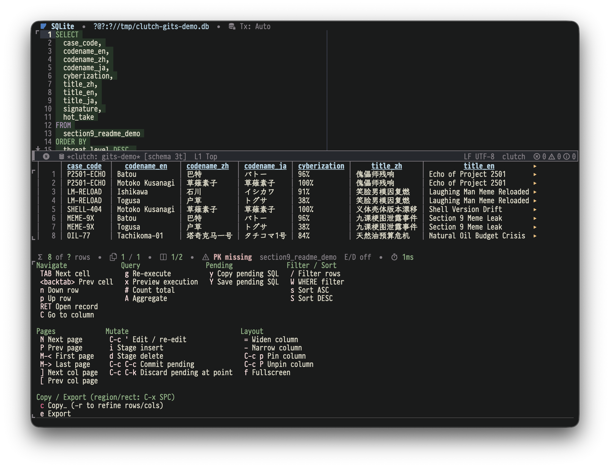

[](https://melpa.org/#/clutch)

<p align="center">
  <picture>
    <source media="(prefers-color-scheme: dark)" srcset="docs/logo/clutch-dark.svg">
    
  </picture>
</p>

<p align="center"><strong>Query and browse databases—and stage SQL row edits—without leaving Emacs.</strong></p>

Clutch keeps queries in editable buffers, shows results in an interactive grid, and stages supported SQL row changes for preview before execution. It provides sidecar-free paths for MySQL, PostgreSQL, XTDB, SQLite, MongoDB, and Redis, plus JDBC access to Oracle, SQL Server, DB2, Snowflake, Redshift, ClickHouse, DuckDB, and other databases.



## Quick Start

The shortest path uses SQLite, which requires only Emacs 29.1+—no protocol package or Java runtime.

### 1. Install Clutch

With MELPA or another package archive configured:

```emacs-lisp
(package-install 'clutch)
```

### 2. Open a SQLite database

```text
M-x clutch-query-sqlite-file
```

Select a SQLite database file. Clutch opens a connected query console in an editable SQL buffer.

### 3. Run a query

```sql
SELECT sqlite_version();
```

Press `C-c C-c`. Clutch executes the region when one is active, otherwise the statement at point, and displays the result below the query buffer.

For MySQL, PostgreSQL, MongoDB, Redis, or JDBC, continue with [Installation Details](#installation-details) and the [user guide](docs/user-guide.md).

## Key Capabilities

- **Keep query context visible:** execute a region or statement without leaving the SQL buffer; results refresh in a split grid, the statement Clutch picks at point flashes, a statement that runs without blocking Emacs keeps a background until it finishes, and the last executed statement stays marked in the fringe on graphical displays or the left margin in terminals.
- **Inspect wide or structured results:** navigate a single-page table, scroll horizontally, open record and full-value views, and preview truncated JSON, XML, text, or BLOB values after a brief pause without dragging the preview across cells during navigation.
- **Edit supported SQL results with guardrails:** stage inserts, updates, and deletes locally, inspect the execution preview, and submit only after validation and confirmation.
- **Navigate with database context:** complete scoped tables and columns, inspect Eldoc and object definitions, follow foreign keys, and reuse cache-first metadata without blocking point motion.
- **Read a plan:** show a statement's PostgreSQL, MySQL or SQLite plan as a tree, with each step's own share of the cost, or of the measured time under `EXPLAIN ANALYZE`.
- **Refine and export results:** apply server-side `WHERE` and `ORDER BY`, use client-side substring filtering, copy selections as TSV, CSV, or Org tables, and export complete pageable results as CSV or TSV with consistent Transient controls for optional headers and clipboard/file destinations.
- **See connection state where it matters:** keep separate query consoles, reconnect from preserved parameters, and view schema-refresh, transaction, timeout, and diagnostic state in the relevant buffers.
- **Choose the backend path you need:** use native or pure-Elisp integrations when available, or the Java 17+ [clutch-jdbc-agent](https://github.com/LuciusChen/clutch-jdbc-agent) for JDBC databases.

Row editing stays within the [row-editing boundaries](docs/user-guide.md#row-editing-boundaries): Clutch stages `UPDATE` and `DELETE` only when it can identify a stable source row.

## Backend Support

| Backend | Support level | Requirements and notes |
|---|---|---|
| MySQL | Core SQL support | Validated against MySQL 5.6, MySQL 8.0, MySQL 8.4 LTS, and MariaDB 10.11 |
| PostgreSQL | Core SQL support | Requires [`pgsql`](https://melpa.org/#/pgsql), available from MELPA |
| XTDB | Basic SQL support over the PostgreSQL protocol | Requires [`pgsql`](https://melpa.org/#/pgsql); staged changes are submitted in Auto mode, and a column of mixed types, unless they are all numbers, is changed with SQL |
| SQLite | Core SQL support | Uses Emacs 29.1+ built-in `sqlite-*` functions; no external dependency |
| Oracle / SQL Server | Core SQL support via JDBC | Requires Java 17+ and `clutch-jdbc-agent.jar` |
| DuckDB | Core SQL model, generic JDBC entry | Uses a file-backed `jdbc:duckdb:...` URL and the DuckDB JDBC driver |
| MongoDB | Basic native document support; optional SQL Interface surface | Native use requires `mongodb.el`; SQL Interface uses `:surface sql-interface` and JDBC |
| Redis | Basic key/value support | Requires `redis.el`; includes command buffers, bounded key browsing, and type-aware values |
| ClickHouse / Snowflake / Redshift / DB2 / generic JDBC | Basic SQL / query-first support | Backend-specific limits apply to editing, transactions, and dialect behavior |

See [Backend support levels](docs/backend-support.org) for the precise support policy and non-relational boundaries.

## Installation Details

The SQLite Quick Start has no optional dependency. For other backends, install only the protocol package you use:

| Backend | Extra Emacs package |
|---|---|
| `:backend mysql` | [mysql.el](https://github.com/LuciusChen/mysql.el) |
| `:backend pg` | [pgsql.el](https://github.com/LuciusChen/pgsql.el) |
| `:backend xtdb` | [pgsql.el](https://github.com/LuciusChen/pgsql.el) |
| `:backend mongodb` | [mongodb.el](https://github.com/LuciusChen/mongodb.el) |
| `:backend redis` | [redis.el](https://github.com/LuciusChen/redis.el) |
| `:backend sqlite` | None; Emacs 29.1+ provides SQLite |
| `:backend jdbc` / Oracle / SQL Server / ClickHouse / DB2 / DuckDB | None in Emacs; uses the bundled JDBC adapter |

If a configured native backend package is missing, Clutch reports it when connecting. Install that package with your package manager, ensure it is on `load-path`, and reconnect.

`nerd-icons` is optional: without it, Clutch uses text symbols and backend names instead of icons. Its availability is checked once per Emacs session, including when it is missing; restart Emacs after installing it during a running session.

JDBC support ships with Clutch, but its runtime requires Java 17+, `clutch-jdbc-agent.jar`, and a database driver jar where applicable. Clutch pins agent 0.2.27, which adds statement warning messages, including SQL Server `PRINT` output, while retaining the earlier value-conversion, metadata-isolation and timeout behavior. On first connection, Clutch can prompt to download the agent and supported drivers; it verifies the configured agent jar against its SHA-256 before startup. See the [JDBC backend guide](docs/jdbc-backend.org) for setup, supported drivers, connection examples, and transaction behavior.

For source checkouts, add Clutch and each native protocol checkout you use to `load-path`:

```emacs-lisp
(add-to-list 'load-path "/path/to/clutch")
(add-to-list 'load-path "/path/to/mysql.el")   ; only for :backend mysql
(add-to-list 'load-path "/path/to/pgsql.el")   ; only for :backend pg
(add-to-list 'load-path "/path/to/mongodb.el") ; only for :backend mongodb
(add-to-list 'load-path "/path/to/redis.el")   ; only for :backend redis
(require 'clutch)
```

Org-Babel integration lives in the separate [ob-clutch](https://github.com/LuciusChen/ob-clutch) package.

## Requirements

- Emacs 29.1+
- MySQL 5.6+, PostgreSQL 12+, or SQLite through Emacs built-in support for the corresponding SQL backends
- Java 17+ only for JDBC backends
- Current `mongodb.el` or `redis.el` for the corresponding native document/key-value backend

MariaDB 10.11 has been live-validated through the native `mysql` backend, including TLS with `mysql_native_password`; other MariaDB versions are expected to be broadly compatible but are not yet part of the regular test matrix. MySQL 5.6 has no native JSON column type, MariaDB exposes `JSON` as checked text, and the older `mysql_old_password` plugin is not supported by the native client.

## Documentation

- [User guide](docs/user-guide.md) — saved connections, the query workflow and export, transactions, password management and encrypted profiles, SSH tunnels, TRAMP origins, SQL files, and everyday commands.
- [Interactive client guide](docs/interactive-client.org) — key bindings, result workflows, object actions, REPL, transient menus, faces, timeouts, and customization.
- [Backend support levels](docs/backend-support.org) — support contracts for Core SQL, basic integrations, MongoDB SQL Interface, DuckDB, and Redis.
- [Native backend guide](docs/native-backends.md) — MySQL, PostgreSQL, XTDB, SQLite, MongoDB and Redis notes, TLS, timeouts, and native backend examples.
- [MongoDB backend guide](docs/mongodb-backend.org) — supported helper syntax, document workflows, and native/SQL Interface boundaries.
- [JDBC backend guide](docs/jdbc-backend.org) — driver setup, connection examples, Oracle and DuckDB notes, transactions, and generic JDBC URLs.
- [Architecture guide](docs/architecture.md) — module layers, backend/surface ownership, connection flow, query/object flow, and JDBC runtime diagrams.
- [Org-Babel guide](docs/org-babel.org) — `ob-clutch` setup, source block examples, header arguments, and connection caching.
- [JDBC agent protocol](docs/jdbc-agent-protocol.md) — sidecar RPC protocol and implementation notes.
- [Product requirements](PRD.md) — stable scope, required workflows, compatibility, and non-goals.

For development, see [CONTRIBUTING.md](CONTRIBUTING.md) for local test targets, the code gate and live database runs, and [AGENTS.md](AGENTS.md) for project contracts and verification policy.

## License

GPL-3.0-or-later. See [LICENSE](LICENSE).
