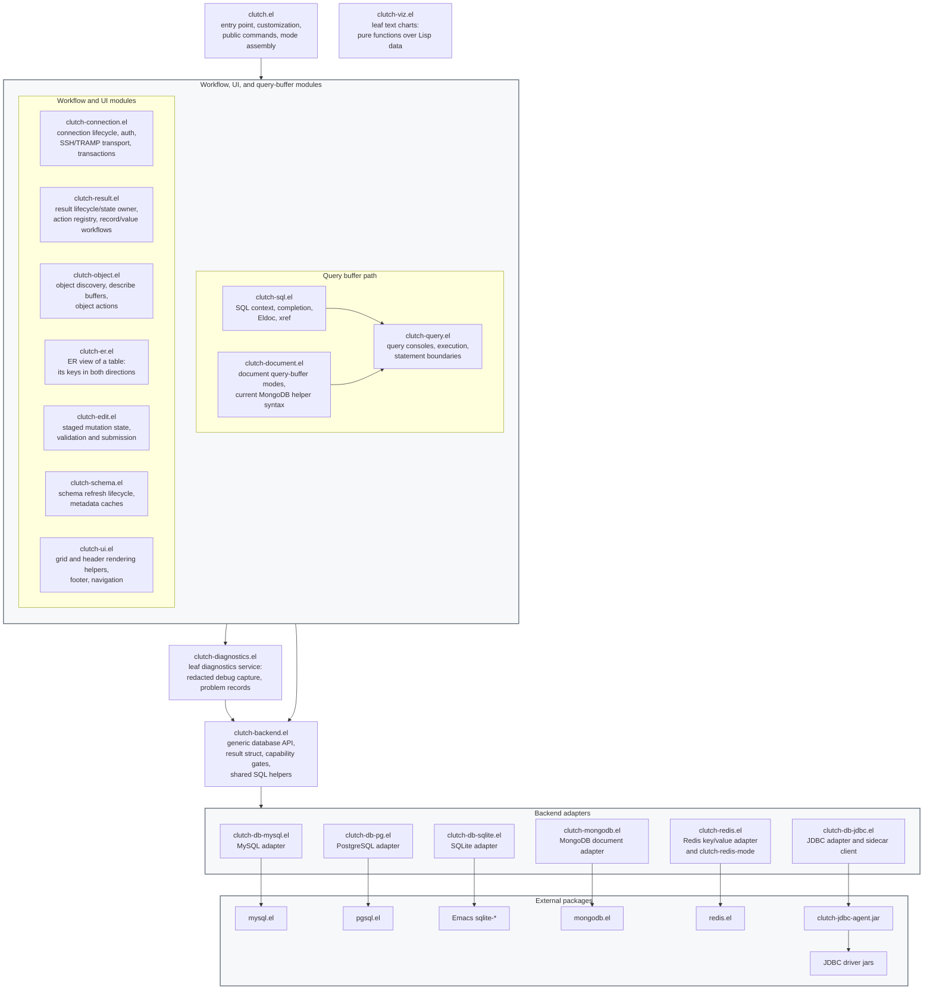
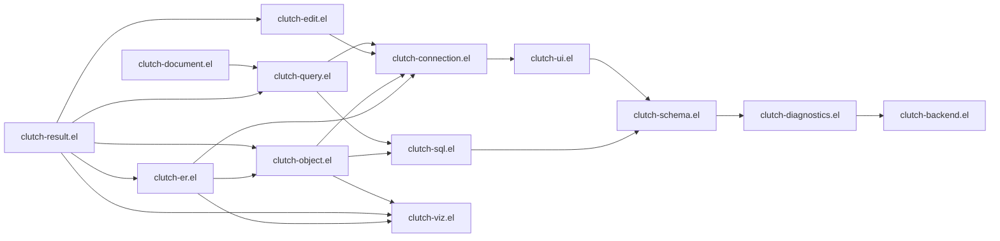
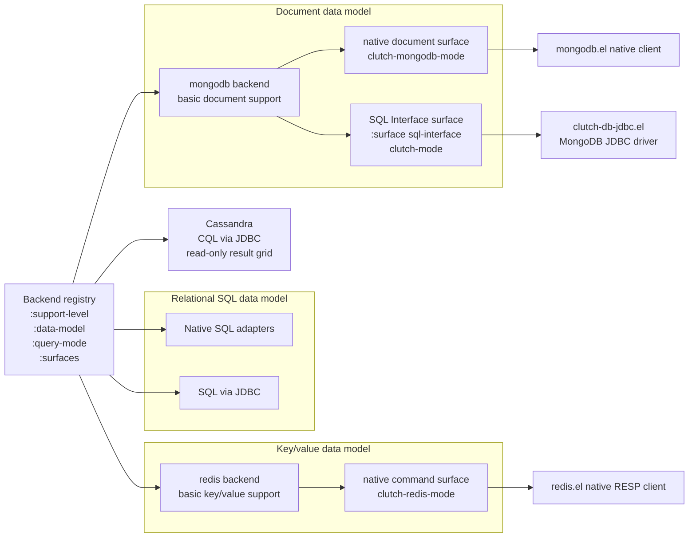
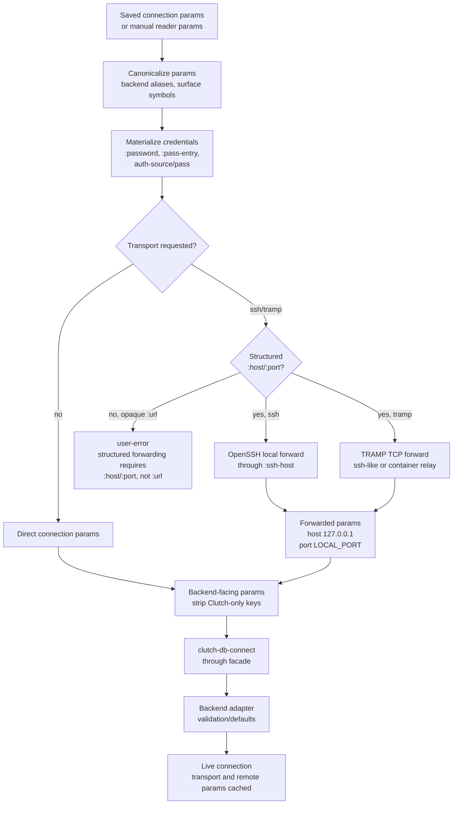
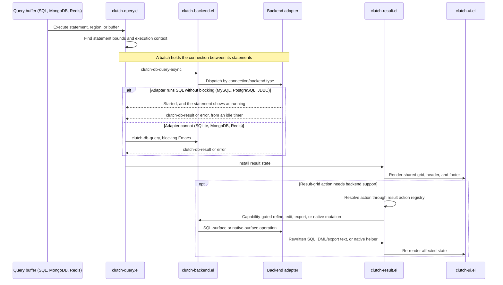
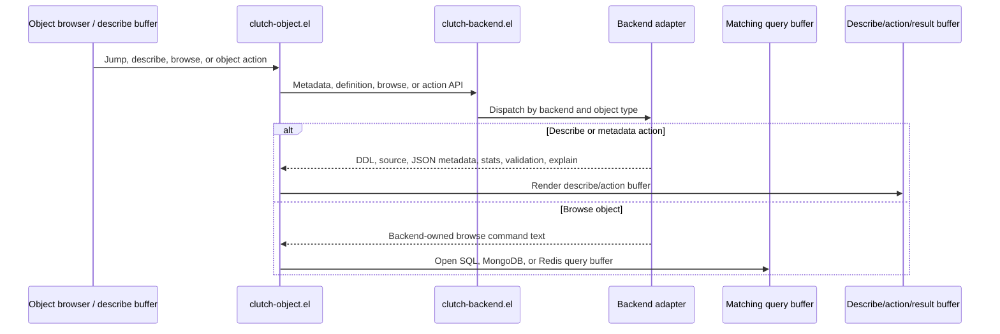
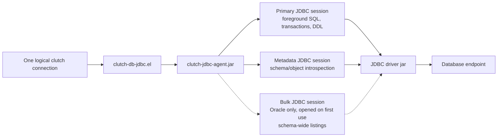

# clutch Architecture

Current module map and boundaries for `clutch`. Design history lives in [`postmortem/`](../postmortem/).

## Layered Module Architecture

Workflow modules call generic `clutch-db-*` operations in `clutch-backend.el` rather than protocol packages directly; adapters own database-specific parameters, metadata, execution, and type mapping.

- **Query modes:** `clutch-query.el` owns console execution and `clutch-mode`, while `clutch-sql.el` owns SQL parsing, completion, Eldoc, and xref. `clutch-document.el` provides `clutch-mongodb-mode` through backend registry metadata; `clutch-redis.el` defines the smaller `clutch-redis-mode` in the adapter layer using lazy `declare-function` references.
- **Results, edits, and UI:** `clutch-result.el` owns result lifecycle, paging/filter/sort, refine mode, query plans, and the result action registry; `clutch-edit.el` owns staged mutation payloads and validation; `clutch-ui.el` provides grid/header rendering helpers.
- **Atomic submission:** `clutch-edit.el` handles statement order and row-count checks while backends implement `clutch-db-call-with-atomic-batch` (Auto-mode transaction or Manual-mode savepoint; JDBC exposes opaque savepoint IDs). Failed savepoint release can roll back cleanly, whereas an unknown commit outcome sets `uncertain` until explicit rollback or reconnect.
- **ER view:** `clutch-er.el` reads cached columns/outgoing keys, queries incoming keys (`clutch-db-referencing-keys`) asynchronously on native PG/MySQL and JDBC via `clutch-connection.el`'s activity lifecycle, draws with `clutch-viz.el`, and persists manual browsing-only JSON relations (also exposed to Record view via `clutch-er-outgoing-relations`).
- **Leaf services:** `clutch-viz.el` draws pure-Lisp text charts with zero Clutch dependencies; `clutch-diagnostics.el` owns redacted debug capture (`*clutch-debug*`) and problem records over the backend facade without depending on `clutch-connection.el`.

## Module Dependencies

Arrows mean `require` (transitive edges omitted). Loading `clutch.el` pulls in the SQL and result workflows; `clutch-document.el` loads on demand.

## Backend And Surface Model

Native backends register in `clutch-backend--registry`; `clutch-db-jdbc.el` adds entries from `clutch-jdbc--driver-metadata` on load (see [backend-support.md](backend-support.md)).

- `mongodb` is a single backend whose default surface is native document (`mongodb.el`) and optional `:surface sql-interface` routes through JDBC.
- `redis` is a separate key/value backend; SQL-only result/mutation actions are gated by the registered data model or SQL Interface surface.
- `xtdb` registers its own backend reusing the PostgreSQL adapter with subtype overrides (postmortem 208); DuckDB currently enters through generic `jdbc`.

## Connection Flow

SSH and TRAMP forwarding sit below the backend layer and rewrite only structured `:host` / `:port` endpoints; opaque `:url` entries are passed through unchanged.

## Query And Object Flow

Execution always starts through `clutch-db-query-async`: async adapters (MySQL, PostgreSQL, JDBC) return immediately and deliver results from an idle timer, while synchronous adapters fall back to `clutch-db-query`. Multi-statement batches reserve their connection across statements, so background metadata and Eldoc check `clutch-db-in-use-p` (not just `clutch-db-busy-p`) before querying. Object browsing asks adapters for metadata, definitions, or backend-specific browse commands opened in the matching query mode.

## JDBC Runtime Shape

The JVM sidecar separates foreground SQL from metadata introspection, and on Oracle opens a third `bulk` session lazily for schema-wide listings so large scans do not stall interactive lookups (see [jdbc-agent-protocol.md](jdbc-agent-protocol.md)).
