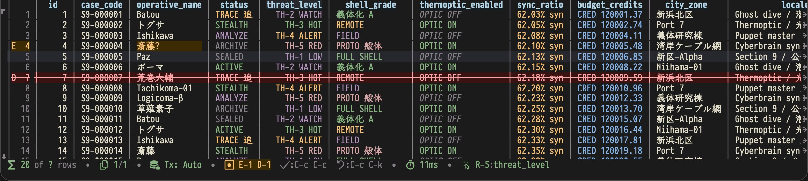
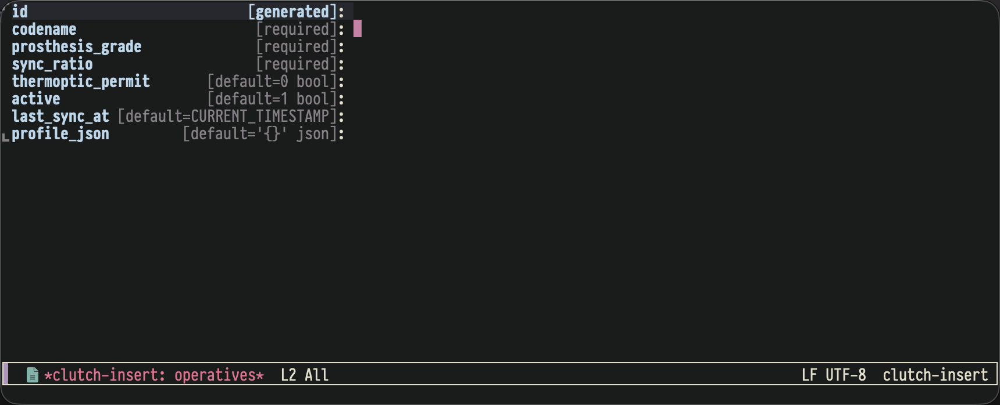
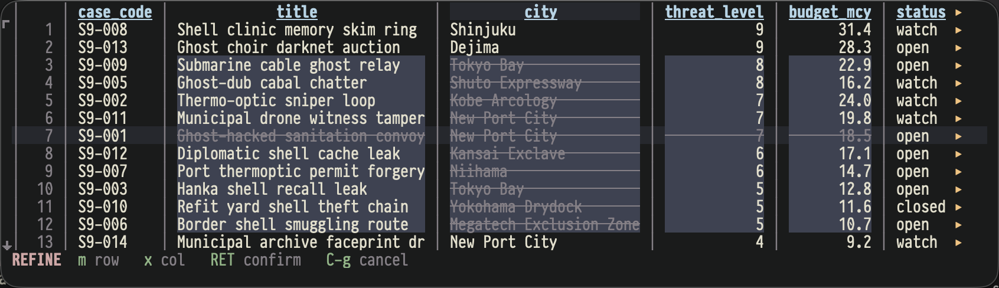
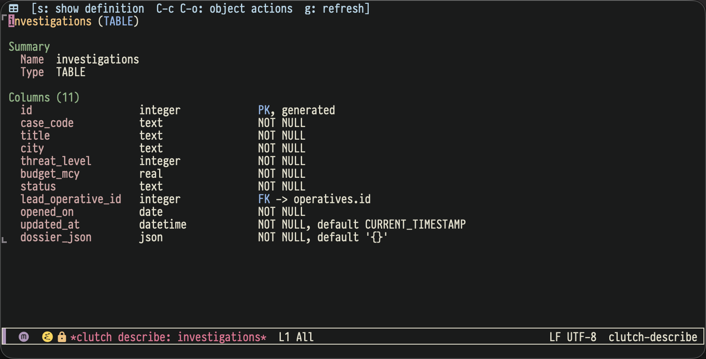

# clutch Interactive Client Guide

Reference for key bindings, result browsing, editing forms, query plans, ER views, object actions, exports, timeouts, and customization.

## SQL Editing (clutch-mode) Key Bindings

| Key | Action |
|---|---|
| `C-c C-c` | Execute region, or the current `;`-delimited statement at point |
| `C-c C-r` | Execute selected region (multiple `;`-delimited statements run sequentially) |
| `C-c C-b` | Execute entire buffer sequentially |
| `C-c C-e` | Connect (in query consoles, reconnects the console's current connection) |
| `C-c C-j` | Jump to a primary object and run its default action |
| `C-c C-d` | Describe object at point, or prompt |
| `C-c C-o` | Show object actions for object at point, or prompt |
| `C-c C-v` | Show the ER view of the table at point, or prompt |
| `C-c C-l` | Switch current schema/database on the active connection |
| `C-c C-s` | Refresh schema metadata now |
| `C-c C-m` | Commit transaction (manual-commit connections) |
| `C-c C-u` | Roll back transaction (manual-commit connections) |
| `C-c C-a` | Toggle auto-commit on/off when supported |
| `C-c TAB` | Invoke SQL identifier completion explicitly (including empty column positions) |
| `C-c ?` | Open the transient menu |

On Oracle, keep the final semicolon in PL/SQL blocks and stored units; put `/` on its own line before the next statement in a script, or to send a block from the REPL (a single block in a console can also end at EOF or end of selection).

Use `C-x o` or `C-x b` to switch to a result buffer. `C-c C-n` and `C-c C-z` are unbound in `clutch-mode` because the inherited `sql-mode` commands expect a SQLi subprocess.

### Execution markers and statement pulse

Clutch marks the first line of the last executed statement with a colored dot (fringe bitmap in GUI frames, `●` in the left margin on terminals, preserving any wider existing margins). When `C-c C-c` picks the statement at point without an active region, it flashes that range with `pulse` before any confirmation prompt (the same applies to Redis commands at point). Set `clutch-pulse-statement-at-point` to `nil` to disable the flash, or customize `pulse-highlight-start-face`.

### Query plans (`clutch-explain-plan`)

Press `E` in `C-c ?` (`M-x clutch-explain-plan`) to view the execution plan for the statement at point (or region) as a tree in `*clutch-plan*`. Pass `C-u` to run `EXPLAIN ANALYZE` on a read-only `SELECT` and display measured times instead of planner costs. Press `g` in `*clutch-plan*` to redraw at the current window width without re-running the query.

- **PostgreSQL & MySQL 8.0.16+ (native or `jdbc:postgresql:` / `jdbc:mysql:`):** Tree view with each step's own cost/time share bar and row count (`EXPLAIN ANALYZE` needs MySQL 8.0.18+; parallel PostgreSQL steps report per-worker averages, so shares are approximate).
- **Native MySQL < 8.0.16:** Falls back to traditional `EXPLAIN` rows without hierarchy or bars.
- **SQLite:** Shows `EXPLAIN QUERY PLAN` steps without cost/time measures.
- **MariaDB and other backends:** Report that plans are unavailable.

### Server notices and warnings

Server notices and warnings appear above the summary of statements that return no rows, and in the REPL for any statement (result grids do not display them yet). Native PostgreSQL needs `pgsql.el` 0.3.1+; native MySQL/MariaDB and JDBC agent 0.2.27+ collect up to 100 statement warnings (such as SQL Server `PRINT` output) and note how many were omitted. Oracle `DBMS_OUTPUT` is not collected here.

### Completion, Eldoc, and alias navigation

- **Alias jump (`M-.`):** Jumps from a table alias (`u` or `u.name`) to its definition in the current statement, including parenthesized single tables like `FROM (users AS u)`. Schema-qualified names (`schema.table`) are not aliases; use `C-c C-d` or `C-c C-j` instead.
- **Identifier completion:** Works via standard CAPF (`M-TAB`, `C-c TAB`, and `TAB` after a `table.` or `alias.` dot), including empty column positions like `SELECT | FROM users`. Accepted identifiers keep their catalog spelling and dialect quoting; `clutch-sql-completion-case-style` affects keywords only.
- **Background metadata & Eldoc:** Native MySQL and PostgreSQL refresh schema, columns, comments, keys, and objects asynchronously when their protocol packages support async queries (foreground commands wait up to 10 seconds if the connection is busy with metadata, interruptible with `C-g`). Cold JDBC completion and Eldoc also fetch column metadata in the background (Oracle searches tables and columns by prefix), and MySQL `HELP` loads asynchronously for Eldoc.
- **Cross-schema & subquery completion:** Qualifying `FROM schema.` or `JOIN schema.` (or comma-separated `FROM` lists) fetches tables for that schema asynchronously on native PostgreSQL/MySQL and JDBC Oracle/SQL Server/DuckDB (file-backed only). Derived-table aliases (`JOIN (SELECT ...) b`) complete their projected columns, including explicit aliases, `*`/`p.*` expansions, nested subqueries, and the first branch of `UNION`/`EXCEPT`/`INTERSECT` (plus `MINUS` on Oracle). CTE output lists and unaliased expressions are outside this lightweight parser.

### Export a query to a file

Run `M-x clutch-export-query` (or `C-c ? e`) to export one read-only `SELECT` (including a read-only `WITH` query) straight to a CSV or TSV file without opening a result grid or disturbing staged edits.

- **Single-query streaming:** PostgreSQL uses `COPY ... TO STDOUT` when `pgsql.el` provides `pgsql-copy-out-async` (values use PostgreSQL's text format: `t`/`f`, `\x` hex `bytea`, `{...}` arrays, session-timezone `timestamptz`). Native MySQL streams decoded rows with `mysql-query-rows-async`, and JDBC streams cursor batches sized by `clutch-jdbc-fetch-size`. On PostgreSQL, streaming exports inside a transaction use a savepoint so cancelling or a write failure keeps earlier transaction work intact.
- **Paged fallback:** Other backends (and sorted grids or older drivers) fetch pages of `clutch-export-page-size` rows (default 2000) independently of `clutch-result-max-rows`. Add an `ORDER BY` on a unique key when relying on paged exports, since separate page queries can otherwise skip or duplicate rows if data changes. Queries with an explicit `LIMIT`/`OFFSET`/`TOP`/`FETCH` run once.
- **Defaults:** Prompt defaults come from `clutch-export-default-format` (`csv`), `clutch-csv-export-default-coding-system` (`utf-8-with-signature`), `clutch-export-default-directory`, and `clutch-export-default-file-name` (all can be set buffer-locally):

```emacs-lisp
(setq clutch-export-default-format 'tsv
      clutch-csv-export-default-coding-system 'utf-8
      clutch-export-default-directory (expand-file-name "~/exports/")
      clutch-export-default-file-name "latest.tsv")
```

- **PostgreSQL `pg_export_snapshot()`:** Needs a top-level transaction. Run it normally and copy with `c`, or materialize it into `CREATE TEMP TABLE ... ON COMMIT DROP` before exporting.
- **Cancellation:** `C-g` in the source buffer cancels an in-flight export without touching any existing destination file.

## Result Browser (clutch-result-mode) Key Bindings

| Key | Action |
|---|---|
| `RET` | Open vertical record view |
| `TAB` / `S-TAB` | Next / previous cell |
| `n` / `p` | Next / previous row (same column) |
| `M-n` / `M-p` | Alias for next / previous row |
| `N` / `P` | Next / previous page (SQL pagination) |
| `M->` / `M-<` | Last row window / first page |
| `#` | Query total row count |
| `A` | Aggregate numeric values (region or current cell; `C-u A` enters refine mode) |
| `]` / `[` | Scroll right / left by column boundary |
| `=` / `-` | Widen / narrow current column |
| `W` | Server-side `WHERE` filter (empty input clears) |
| `/` | Client-side substring filter on the current page (empty input clears) |
| `s` | Cycle current-column sort: unsorted → ASC → DESC → unsorted |
| `C` | Jump to a visible column |
| `{` / `}` | First / last visible data column |
| `?` | Show source column type and nullability (even through aliases) |
| `R` | Add a manual relation from the column at point ([Relations added by hand](#relations-added-by-hand)) |
| `g` | Re-execute query |
| `C-c '` | Edit / re-edit cell at point |
| `i` | Stage a new row (insert form) |
| `I` | Clone current row into a prefilled insert form (omitting PK values) |
| `d` | Stage current row or region for deletion |
| `C-c C-c` | Submit all staged changes (`INSERT` → `UPDATE` → `DELETE`) |
| `C-c C-m` | Commit server transaction |
| `C-c C-u` | Roll back server transaction |
| `C-c C-a` | Toggle auto-commit when supported |
| `C-c C-k` | Discard staged change at point |
| `c` | Copy menu (TSV / CSV / Org table / `INSERT` / `UPDATE`; `-r` refines selection, `-h` toggles headers) |
| `k` | Copy SQL, table metadata, and result sample as Markdown for an external agent |
| `v` | Open full cell value viewer (JSON / XML / BLOB auto-detected) |
| `\|` | Pipe current cell through a shell command |
| `e` | Export menu (CSV / TSV / `INSERT` / `UPDATE`; `-h` headers, `-f` Clipboard vs File) |
| `f` | Toggle fullscreen |
| `C-c ?` | Open the transient menu |

### Result grid behavior

- **Navigation & row numbers:** The result browser draws its own row-number column and turns off native `display-line-numbers-mode`. Use `{` / `}` for data-grid edges (`C-a` / `C-e` stay on physical line edges).
- **Searching column headers (`C-s` / `C-r`):** During native `isearch`, Clutch temporarily exposes the header row as searchable buffer text (hiding the fixed header line while point is there). `C-r` searches backward from data into headers, `C-s` wraps into them, `RET` lands on that column's first data cell, and `C-g` returns to where you started. Full column names match even when truncated on screen.
- **Sorting (`s`) & filtering (`/` / `W`):** Simple table and single-table CTE queries sort on the server via `ORDER BY`; `UNION`, grouped, or derived results sort the loaded page locally (shown as `page` in the footer). Click a column header or press `C` then `s` to sort any column. `/` filters only the loaded page without re-querying and shows matching counts separately from the page range. Refreshes keep headers visible and preserve manual column widths when columns don't change.
- **Previews:** `v` opens the full value in a buffer. Set `clutch-cell-preview-style` to `child-frame` for an automatic formatted popup on truncated cells after `clutch-cell-preview-delay` (bounded by `clutch-cell-preview-max-size`); moving away dismisses it immediately. Short JSON/XML cells also get lightweight inline highlighting.
- **Staged status & preview SQL:** The footer places transaction state and staged counts (`E-<n>`, `D-<n>`, `I-<n>`) first. In `C-c ?`, press `x` (Preview SQL) to inspect staged DML or the active query, and copy or save pending SQL from the Edit group. When a query has no safe row identity, the footer notes `Update/delete unavailable` (row-identity rules and CTE limits are in [Row-editing boundaries](user-guide.md#row-editing-boundaries)).
- **Schema/namespace safety:** Each result remembers the database, schema, and search path it ran under. If the session later switches elsewhere (or an automatic reconnect lands on a different path), staging, submitting, paging, counting, and full export refuse until you switch back or rerun (`g`).
- **Copy vs Export (`c` / `e`):** `c` operates on the current cell or region (normal or rectangular `C-x SPC`). `e` always exports all rows (fetching all pages on pageable queries, ignoring any `/` filter, and streaming in one query for CSV/TSV files on JDBC and recent native MySQL/PostgreSQL drivers). File exports write in ~1 MB chunks to a temp file and atomically replace the destination on success (preserving symlinks; `.gz` and similar filename transforms run in memory after encoding). If an `INSERT` selection includes a computed column or ambiguous table, `MY_TABLE` is used as a placeholder target.

### CSV and TSV formatting conventions

By default, CSV/TSV copy and export distinguish three values:

- SQL `NULL` → unquoted empty field
- Empty string → `""`
- Literal text `NULL` → `NULL`

(Oracle treats empty strings as SQL `NULL`, so they follow the `NULL` format.)

Customize `clutch-export-null-value-text` to change the `NULL` marker, and `clutch-csv-delimiter` (comma by default; TSV always uses tabs) for semicolon-delimited spreadsheets:

```emacs-lisp
(setq clutch-export-null-value-text "NULL"
      clutch-csv-delimiter ?\;)
```

With `clutch-export-null-value-text` set to `"NULL"`, SQL `NULL` writes as `NULL`, empty strings as empty fields, and literal `"NULL"` text is quoted as `"NULL"`.

### BLOB Viewer

Press `v` on a BLOB cell, then `x` to toggle between text and hex (showing up to 256 leading bytes in hex, or up to 1024 bytes in text for raw BLOBs over 64 KiB; invalid UTF-8 JSON-like BLOBs open directly in hex). With recent JDBC agents, Clutch receives up to 256 preview bytes and shows the total size (`<BLOB preview; N total>` for >64 KiB locators or older agents). Incomplete JDBC BLOB/CLOB previews can be viewed but not edited, cloned, or exported; cast to text in SQL if you need to export binary data.

### Edit Buffer Keys

`C-c '` opens a single-cell editor (JSON columns and JSON-looking text jump straight into a JSON editor where `C-c C-c` stages directly). Closing a result buffer with staged changes asks before discarding them.

| Key | Action |
|---|---|
| `M-TAB` / `C-M-i` | Complete enum / bool-like values |
| `C-c '` | Open JSON sub-editor |
| `C-c .` | Set date/time field to "now" |
| `C-c C-n` | Set database `NULL` (nullable columns) |
| `C-c C-d` | Set database `DEFAULT` (columns with a default) |
| `C-c C-c` | Stage edited value |
| `C-c C-k` | Cancel |

An empty edit buffer stages an empty string (displayed as `<empty>` in the grid); typing literal `NULL` or `DEFAULT` stages text, whereas `C-c C-n` / `C-c C-d` stage database `<null>` / `<default>`.



### Per-column displayers

You can customize how a specific table/column displays in the grid without changing its stored value (`clutch-full-value`). Return a propertized string, or `nil` to fall back to the default renderer:

```emacs-lisp
(defun my-clutch-status-displayer (value)
  (pcase value
    (0 (propertize "pending" 'face 'warning))
    (1 (propertize "active" 'face 'success))
    (2 (propertize "done" 'face 'shadow))))

(dolist (table '("orders" "tasks" "jobs"))
  (clutch-register-column-displayer
   table "status" #'my-clutch-status-displayer))
```

Table and column names match case-insensitively. Use `clutch-unregister-column-displayer` to remove one. Keep displayers fast and side-effect-free (no queries, file I/O, or async work).

### Insert Buffer Keys

`i` opens an insert form; `I` clones the current row (omitting PK values). Press `C-h m` inside the form for all bindings.

| Key | Action |
|---|---|
| `RET` | Accept current field and move to next |
| `TAB` / `S-TAB` | Next / previous field |
| `M-TAB` / `C-M-i` | Complete field value (CAPF, falling back to chooser) |
| `C-c '` | Edit JSON field in a dedicated buffer |
| `C-c .` | Set date/time field to "now" |
| `C-c C-y` | Import TSV / CSV from region or kill ring |
| `C-c C-n` | Set field to SQL `NULL` |
| `C-c C-e` | Set field to empty string |
| `C-c C-d` | Omit field (use database default) |
| `C-c C-c` | Stage new row / update staged insert |
| `C-c C-k` | Cancel |

Untouched blank fields are omitted so server defaults and triggers apply. Invalid inputs are marked inline while typing; staging jumps to the first invalid field. `C-c C-y` prefills the form for one imported row or stages multiple rows directly (matching by header name when present, or positionally otherwise). Multiline pastes are preserved. Opening and cancelling a JSON sub-editor leaves the parent field untouched.



### Visual Refine Mode (`c -r` / `C-u A`)

To exclude specific rows or columns before copying or aggregating, select a region (normal `C-SPC`, rectangular `C-x SPC`, or mouse; Clutch expands it to a full cell rectangle), press `c`, toggle `-r`, and pick a format (or press `C-u A` for aggregation).

| Key | Action |
|---|---|
| `m` | Toggle exclusion of row at point |
| `x` | Toggle exclusion of column at point |
| `RET` | Confirm copy / aggregate |
| `C-g` | Cancel |



## Record View (clutch-record-mode) Key Bindings

| Key | Action |
|---|---|
| `RET` | Expand long field / follow first foreign key |
| `r` | Follow any outgoing relation (FK or manual), prompting if multiple apply |
| `n` / `p` | Next / previous row |
| `C-c '` | Edit / re-edit current field |
| `C-c C-c` | Submit all staged changes in the result |
| `C-c C-k` | Discard staged change at field |
| `C-c C-m` / `C-c C-u` / `C-c C-a` | Commit / roll back / toggle auto-commit |
| `I` | Clone current record into a prefilled insert form |
| `v` | Inspect field value (JSON / XML / BLOB) |
| `g` | Refresh |
| `q` | Quit |
| `C-c ?` | Transient menu |

Foreign-key targets appear beside their fields (composite keys follow all constituent columns together; aliased columns share staged drafts with their source column). Record view tracks its row across client-side sorting and filtering; staging an edit returns to the same field.

## Describe View (clutch-describe-mode) Key Bindings

| Key | Action |
|---|---|
| `s` | Show DDL / source |
| `g` | Refresh describe buffer |
| `q` | Quit |
| `C-c C-d` | Describe object at point, or prompt |
| `C-c C-o` | Show object actions |

## ER View (clutch-er-mode) Key Bindings

Open with `C-c C-v` (`M-x clutch-er-diagram`), `v` in `C-c ?`, or `r` in object actions (`C-c C-o`). Available on native PostgreSQL, MySQL, and SQLite, and on JDBC drivers that expose incoming keys with agent 0.2.28+.

The top section shows a navigable table overview (click or use arrow keys to move across branches; `+` marks an unopened branch, `[+N]` counts folded neighbors, `(shown)` marks cycles/cross-links, and manual links are dotted). Below it sit the table's columns and relations:

- `→ customers.id`: outgoing foreign key; `← refunds.order_id`: incoming foreign key; adjacent composite-key columns are bracketed together.
- `◆` primary key, `●` foreign key, `○` manual relation only. Moving point highlights connected lines without redrawing.
- On CJK/ambiguous-width displays or terminals, Clutch falls back to ASCII (`*`, `o`, `-->`, `<--`); customize `clutch-er-charset` (`auto`, `unicode`, `ascii`) to override. Press `g` after changing font size to realign composite brackets.
- Native PostgreSQL, MySQL, and JDBC load ER metadata asynchronously (press `C-g` to cancel; on JDBC this leaves primary SQL running). On MySQL 5.6/5.7, reverse FK lookup uses InnoDB's foreign-key dictionary when readable; SQLite scans all tables in the database since it has no FK index.

| Key | Action |
|---|---|
| `RET` | Open overview table or follow relation at point |
| Arrow keys | Move between overview nodes (ordinary movement in fields) |
| `o` | Jump between displayed table node and its last visited field |
| `+` | Expand overview table or folded marker |
| `TAB` | Toggle all columns vs key columns only |
| `n` / `p` | Next / previous overview table |
| `a` | Add a manual relation starting at column at point |
| `e` / `d` | Edit / delete manual relation at point |
| `g` | Reload metadata (`C-u g` also recenters the overview) |
| `C-c C-o` | Show object actions |

### Relations added by hand

Add undocumented relations with `a` in ER view or `R` in a single-table result buffer. Clutch prompts for referencing columns, target table, and target columns (matching source column names by default; use comma-separated lists for composite relations). Manual relations show with dotted links in ER view and work with `r` in Record view, and are used for browsing only (never for row identity or staged edits). Missing columns remain visible as `(missing column)` so you can edit or delete them.

Relations are saved in a stable, Git-friendly JSON file: either `:relations-file` on the connection or a per-connection file in `clutch-er-relations-directory`:

```json
{
  "version": 1,
  "relations": [
    {
      "from": {"table":"orders"},
      "to": {"schema":"ref","table":"regions"},
      "columns": [["region","code"],["country","country"]]
    }
  ]
}
```

## Typical Workflows

### Query, paginate, filter, and sort

```text
1. Write SQL:  SELECT * FROM orders;
2. C-c C-c     Run → paginated grid (default 500 rows/page)
3. N / P       Next / previous page; M-> last window; # total count
4. ] / [       Scroll horizontally by column boundary
5. W           Add server-side WHERE filter (empty input clears)
6. /           Filter loaded page locally (empty input clears)
7. s           Cycle column sort (server ORDER BY or local page sort)
8. A           Aggregate selected numeric cells (sum/avg/min/max)
```

### Follow foreign keys

```text
1. SELECT * FROM orders; → C-c C-c
2. Move to an underlined FK value (e.g. user_id), press RET for Record view
3. Press RET on the FK field (or r to choose among multiple/manual relations)
```

### Stage edits, inserts, and deletes

```text
1. Run a single-table SELECT → C-c C-c
2. C-c ' on a cell to edit; i to insert a row; I to clone; d to stage deletion
3. C-c C-k discards the staged change at point; C-c ? x previews the SQL batch
4. C-c C-c in the result buffer confirms and submits (INSERT → UPDATE → DELETE)
```

Confirmation previews show readable SQL literals, while execution uses parameterized queries under the hood on native MySQL, PostgreSQL, SQLite, and JDBC.

## REPL Mode

```text
M-x clutch-repl        ;; Open *clutch REPL*
C-c C-e                ;; Connect
db> SELECT * FROM users;
```

Statements execute automatically on `;` (multi-line input shows `->`), and `SELECT` results open in the Result Browser. The REPL binds `C-c C-e`, `C-c C-m`, `C-c C-u`, `C-c C-a`, `C-c C-j`, `C-c C-d`, `C-c C-o`, and `C-c C-l`.

Extra `M-x` commands: `clutch-describe-refresh`, `clutch-object-show-ddl-or-source`, `clutch-describe-dwim`, `clutch-act-dwim`, `clutch-result-copy-pending-sql`, `clutch-result-save-pending-sql`, and `clutch-copy-context-for-agent`.

## External Agent Context

`M-x clutch-copy-context-for-agent` (or `k` in the main/result transient) copies a Markdown summary to the kill ring for ChatGPT, Claude, or another assistant without running any SQL:

- The active query (selected region / DWIM statement in `clutch-mode`, or effective query with `WHERE` in `clutch-result-mode`)
- Connection, backend, and schema info
- Referenced table metadata from the describe cache (columns, comments, PK/FK tags, warmed indexes)
- A bounded sample from the current or matching result buffer (excluding hidden row-identity columns; errors during metadata lookup are included explicitly)

## Query Console

`clutch-query-console` opens `*clutch: NAME*` and connects before displaying the buffer (failed connections do not leave empty buffers behind).

- **Reconnecting (`C-c C-e`):** In a console, `C-c C-e` reconnects the console's own session, moving attached results and keeping the commit mode (unless the saved entry changed something other than `:password` / `:pass-entry`, in which case it connects the console alone so staged changes cannot hit another server). Reopening a disconnected console via `clutch-query-console` reconnects while preserving any switched schema/database. Use `M-x clutch-query-console` to move to a different connection.
- **Indirect edits (`clutch-edit-indirect`):** Share their console's session until connected elsewhere with `C-c C-e`, at which point the edit owns its own session and closes it on `C-c C-k` or kill.
- **Paste cleanup:** Pasting into a console strips trailing whitespace, mixed indentation, and CRLF in the pasted region only. Disable with `(setq clutch-console-yank-cleanup nil)`.
- **Persistence:** Console buffers auto-save under `clutch-console-directory` (default `~/.emacs.d/clutch/`) keyed by connection identity hash, so renaming a saved connection keeps its buffer content.

Suggested global binding:

```emacs-lisp
(global-set-key (kbd "C-c d") #'clutch-query-console)
```

## Object Workflow

- `C-c C-j` resolves the object at point or opens a flat annotated picker (`clutch-primary-object-types` defaults to `TABLE`, `VIEW`, `SYNONYM`, `COLLECTION`, `KEY`; slower categories warm in the background). Default `RET` actions: browse (`SELECT *` / MongoDB find / Redis read) for tables/views/synonyms/collections/keys, show source for routines/triggers, show DDL for indexes/sequences. Works smoothly with [orderless](https://github.com/oantolin/orderless) annotations (`&public`, `&synonym`, `&view`).
- `C-c C-d` describes the object at point or prompts. Describe buffers stay separate per connection.
- `C-c C-o` opens the shared object action menu (also exposed via Embark when installed): `d` describe, `s` show DDL/source, `c` compare table definition, `r` ER view, `j` jump to target (indexes/triggers/synonyms), `n` copy name, `f` copy qualified name.



### Schema and database switching (`C-c C-l`)

`C-c C-l` (`clutch-switch-schema`) switches namespaces per backend: `USE` (MySQL, DuckDB file-backed catalog), `SET search_path` (PostgreSQL), business schema (Oracle), logical database (MongoDB), or reconnect with updated URL (ClickHouse). Generic JDBC URLs and Redis do not list schema candidates.

Clutch also tracks manual session switches typed in the console (`USE` / `DROP` on MySQL, `SET`/`RESET`/`DISCARD`/`PREPARE` on PostgreSQL, `USE` on SQL Server, `ALTER SESSION SET CURRENT_SCHEMA` on Oracle, `USE`/`SET`/`RESET` on DuckDB, and `SELECT` on Redis), restoring the full PostgreSQL `search_path` on idle reconnect once committed. Switches hidden inside procedures, PL/SQL, `DO`/`CALL`, `SELECT set_config`, `SET ROLE`, Redis `MULTI/EXEC`, or DuckDB attached/in-memory databases are not followed across reconnects.

### Compare table definitions

Press `c` in object actions (`C-c C-o`) or run `M-x clutch-compare-table-definition` to diff a table's DDL against another saved connection of the same dialect in Ediff (defaulting to the same schema and table name). Press `q` in Ediff to return. On PostgreSQL, the comparison covers columns, types (including precision/scale and schema-qualified custom/array types), defaults, and `NOT NULL`, and is labeled `Columns only` (omitting keys, constraints, and indexes).

## Embark Integration (optional)

When [embark](https://github.com/oantolin/embark) is installed, Clutch registers a `clutch-object` target type in four places:

- **`clutch-mode`** — symbol at point
- **`clutch-repl-mode`** — symbol at point
- **`completing-read` minibuffer** — current candidate in `C-c C-j` / `C-c C-d` / `C-c C-o`
- **Describe / definition buffers** — displayed object

| Key | Action |
|---|---|
| `d` | Describe object |
| `s` | Show definition |
| `c` | Compare table definition |
| `r` | ER diagram (tables) |
| `i` / `e` / `v` / `t` | MongoDB: index insight / explain sample / validation / stats |
| `j` | Jump to target (synonyms, indexes, triggers) |
| `n` / `f` | Copy object name / fully-qualified name |

Without Embark, `C-c C-o` provides the same actions in a `transient` menu.

## Transient Menus

Requires `transient` (built into Emacs 28.1+). Press `C-c ?` in any Clutch buffer:

- **SQL console:** Connection (including `S` Prepare SSH), Objects (including `v` ER view), Transaction (shown only on transaction-capable connections), Run (execute / export / `E` explain plan), and Tools (REPL, indirect edit, `k` copy agent context).
- **Redis console:** `C-c ? x` and `C-c C-c` run the current line (semicolons stay part of the Redis command).
- **Result buffer:** Query group includes Preview SQL (`x`); Edit group shows staged counts and reveals Submit, Discard, and Copy/Save staged SQL (`y`/`Y`) when changes exist; Inspect group opens full viewers (`v`).
- **Record buffer:** Navigate, Inspect (`v`), Mutate (`C-c '`, `C-c C-c`, `C-c C-k`, `I`), and Refresh/Quit.

## Faces

Customize via `M-x customize-group RET clutch RET`:

| Face | Purpose |
|---|---|
| `clutch-field-name-face` | Column headers, insert labels, and record labels |
| `clutch-header-face` / `clutch-header-active-face` | Non-field header text and active header cell |
| `clutch-border-face` | Table borders and separators |
| `clutch-null-face` | `NULL` cells |
| `clutch-modified-face` / `clutch-pending-delete-face` / `clutch-pending-insert-face` | Staged edit, delete, and insert markers |
| `clutch-fk-face` | Foreign-key cells |
| `clutch-executed-sql-marker-face` / `clutch-failed-sql-marker-face` | Last SQL execution marker |
| `clutch-running-sql-marker-face` / `clutch-cancelling-sql-marker-face` | Running / cancelling SQL marker |
| `clutch-running-sql-face` / `clutch-cancelling-sql-face` | Running / cancelling SQL background highlight |
| `clutch-error-summary-face` | Error summaries in result buffers |
| `clutch-object-type-face` | Object type labels |
| `clutch-object-source-face` / `clutch-object-public-source-face` | Object schema/owner annotations |
| `clutch-insert-field-tag-face` | Insert-form metadata tags |
| `clutch-insert-field-error-face` / `clutch-insert-inline-error-face` | Inline validation errors |
| `clutch-insert-active-field-face` / `clutch-insert-active-field-name-face` | Active field in insert buffers |
| `clutch-er-title` / `clutch-er-table` / `clutch-er-key` | ER view header, table names, and key markers |
| `clutch-er-reference` / `clutch-er-manual` / `clutch-er-highlight` | ER view FK links, manual links, and active highlight |

## Query Timeout and Interrupt

### Timeouts

- `clutch-connect-timeout-seconds` (default 10s), overridable via `:connect-timeout`
- `clutch-read-idle-timeout-seconds` (default 30s), overridable via `:read-idle-timeout`
- `clutch-query-timeout-seconds` (default `nil`, no limit; server limits still apply), overridable via `:query-timeout` on PostgreSQL and JDBC
- `clutch-jdbc-rpc-timeout-seconds` (default 30s), overridable via `:rpc-timeout` on JDBC

### Asynchronous execution and cancellation (`C-g`)

On native MySQL (with `mysql-query-async`), native PostgreSQL (`pgsql.el` 0.2.0+), and JDBC, statements, paging, server sorting, row counts, and full exports run without blocking Emacs:

- While running, the statement shows an amber marker, `clutch-running-sql-face` background, and elapsed time in the mode line; the connection refuses other commands until finished (for JDBC, remaining cursor batches also fetch in the background).
- Pressing `C-g` in the console, REPL, or result buffer switches the marker to red (`clutch-cancelling-sql-face`) and requests server cancellation. It stops any remaining statements in a batch and reports either `Query cancelled` or the result if the statement finished first. Press `C-g` a second time to quit normally.
- On JDBC, `C-g` during a background cursor fetch closes the connection (next command reconnects); during file export while Emacs writes a batch, it closes the cursor and keeps the connection and transaction.
- Async queries have no client read-idle timeout; set `clutch-query-timeout-seconds` or `:query-timeout` on PostgreSQL/JDBC if you want a cap. Running `clutch-disconnect` mid-query closes immediately and warns that the server outcome is unknown.
- **Synchronous backends** (SQLite, MongoDB, Redis, older protocol packages): statements block while running. `C-g` cancels and reuses the session when supported (JDBC `cancel`, MySQL `KILL QUERY` + drain, PostgreSQL `CancelRequest` + drain), falling back to disconnect/reconnect when recovery fails or is unsupported.

### Debugging (`clutch-debug-mode`)

Enable `M-x clutch-debug-mode`, reproduce the failure, and open `*clutch-debug*`. It captures redacted trace events (bounded by `clutch-debug-event-limit`, default 25), problem records, generated internal SQL, and JDBC stderr/stack traces.

## Additional Customization

- `clutch-cell-preview-style` (`nil` or `child-frame`), `clutch-cell-preview-delay` (0.25s), `clutch-cell-preview-max-size` (`'(0.65 . 0.45)`)
- `clutch-column-width-max` (30), `clutch-column-width-step` (2), `clutch-column-padding` (1), `clutch-result-window-height` (0.33), `clutch-result-max-rows` (500)
- `clutch-sql-product` (default `mysql`): fallback `sql-mode` product for object definitions
- `clutch-column-displayers`: per-table/per-column display functions
- `clutch-number-format` (default `nil`): DecimalFormat-style display pattern for decimal numbers (e.g. `"#,##0.00"` or `"#,##0.##"`, half-up rounding, integers untouched; copy/export/editing keep raw values). Separators come from `clutch-number-grouping-separator` (`","`) and `clutch-number-decimal-separator` (`"."`). Re-run (`g`) to apply to an open result.
- `clutch-object-warmup-idle-delay-seconds` (0.5s), `clutch-schema-refresh-idle-delay-seconds` (0.5s)
- `clutch-csv-export-default-coding-system` (`utf-8-with-signature`), `clutch-export-default-format` (`csv`), `clutch-export-default-directory`, `clutch-export-default-file-name`, `clutch-export-null-value-text` (`""`), `clutch-csv-delimiter` (`?,`), `clutch-export-page-size` (2000)
- `clutch-jdbc-fetch-size` (default 500, range 1–10,000)
- `clutch-primary-object-types` (`'("TABLE" "VIEW" "SYNONYM" "COLLECTION" "KEY")`)
- `clutch-sql-completion-case-style` (`preserve`, `downcase`, or `upcase` for SQL keywords; identifiers always keep catalog spelling and dialect quoting)
- `clutch-agent-context-max-result-rows` (20), `clutch-agent-context-max-cell-width` (200)
